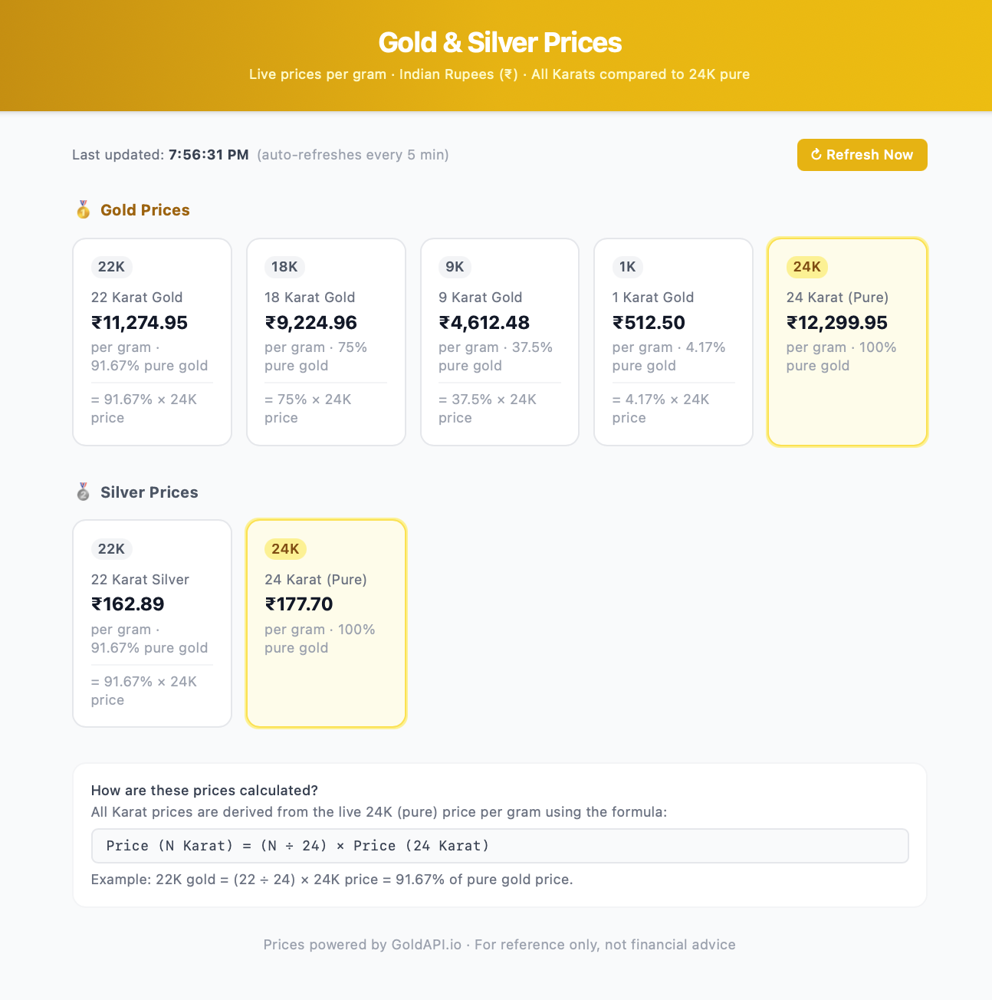

# 💰 Gold & Silver Prices

A modern and responsive web application that displays **live Gold and Silver prices** in **Indian Rupees (₹)** for multiple purity levels (Carats). Rates are streamed live from the [Lawat Jewellers live rate page](http://www.lawatjewellers.com/liverate.html) and update the moment the site changes them.



---

## ✨ Features

- 📈 Live Gold & Silver prices
- 💎 Supports multiple gold purities (per 10 g)
  - 24K (Pure)
  - 22K
  - 18K
  - 14K
  - 9K
- 🥈 Silver prices (per kg)
  - .999 (Pure)
  - 92.5
- 🇮🇳 Prices displayed in Indian Rupees (₹)
- 🔄 Live updates over a socket connection
- 🔃 Manual "Reconnect" button
- 📱 Fully responsive design
- 🎨 Clean card-based UI
- 🧮 Automatic carat price calculation from 24K price

---

## 📷 Preview

> Replace this image with your own project screenshot.

```
/assets/screenshot.png
```

---

## 🚀 Tech Stack

- React + Vite
- Tailwind CSS
- socket.io-client (live rate stream)

---

## 📂 Project Structure

```
src/
├── components/
│   ├── Header.jsx
│   ├── LoadingSpinner.jsx
│   ├── MetalSection.jsx
│   └── PriceCard.jsx
├── hooks/
│   └── useMetalPrices.js
├── services/
│   └── liveRates.js
├── App.jsx
└── index.css

```

---

## ⚙️ Installation

Clone the repository

```bash
git clone https://github.com/your-username/gold-silver-prices.git
```

Navigate to the project folder

```bash
cd gold-silver-prices
```

Install dependencies and start the dev server

```bash
npm install
npm run dev
```

Then open http://localhost:5173/

---

## 🔑 Rate Source

Rates come from the [Lawat Jewellers live rate page](http://www.lawatjewellers.com/liverate.html), which streams them over socket.io. No API key is needed. The app uses the **SELL** rate of:

- **GOLD RTGS 99.50** as the 24 carat gold rate (per 10 g)
- **Silver .999 RTGS** as the pure silver rate (per kg)

See `src/services/liveRates.js`.

---

## 📊 Price Calculation

All carat prices are calculated from the live **24 carat** rate (GOLD RTGS 99.50).

Formula:

```
Price (N Carat) = 24 Carat rate ÷ 24 × N
```

Example:

```
18K Price = 145779 ÷ 24 × 18 = 1,09,334.25
```

92.5 silver is calculated from the Silver .999 RTGS rate:

```
92.5 Silver = .999 rate × 92.5%
```

Purity Chart

| Carat | Purity |
|-------|---------|
| 24K | 99.5% |
| 22K | 91.67% |
| 18K | 75% |
| 14K | 58.33% |
| 9K | 37.5% |

---

## 🎨 UI Features

- Modern card layout
- Golden theme
- Responsive grid
- Price highlighting
- Live rate updates
- Manual reconnect button
- Live update timestamp

---

## 📱 Responsive Design

The application is optimized for:

- Desktop
- Laptop
- Tablet
- Mobile devices

---

## 🔄 Live Updates

Prices update automatically whenever the rate source pushes a new rate.

If the connection drops, use the **Reconnect** button.

---

## 📌 Future Improvements

- Historical price charts
- Currency selector
- Dark mode
- Multiple country support
- Price alerts
- Favorite metals
- Offline caching
- Daily/Weekly trends

---

## 🤝 Contributing

Contributions are welcome!

1. Fork the repository
2. Create a new branch

```bash
git checkout -b feature-name
```

3. Commit your changes

```bash
git commit -m "Added new feature"
```

4. Push to the branch

```bash
git push origin feature-name
```

5. Open a Pull Request

---

## 📄 License

This project is licensed under the MIT License.

---

## 🙌 Acknowledgements

- Lawat Jewellers for live precious metal rates
- Open-source community
- All contributors

---

## ⭐ Support

If you found this project helpful, consider giving it a ⭐ on GitHub.

Happy Coding! 🚀